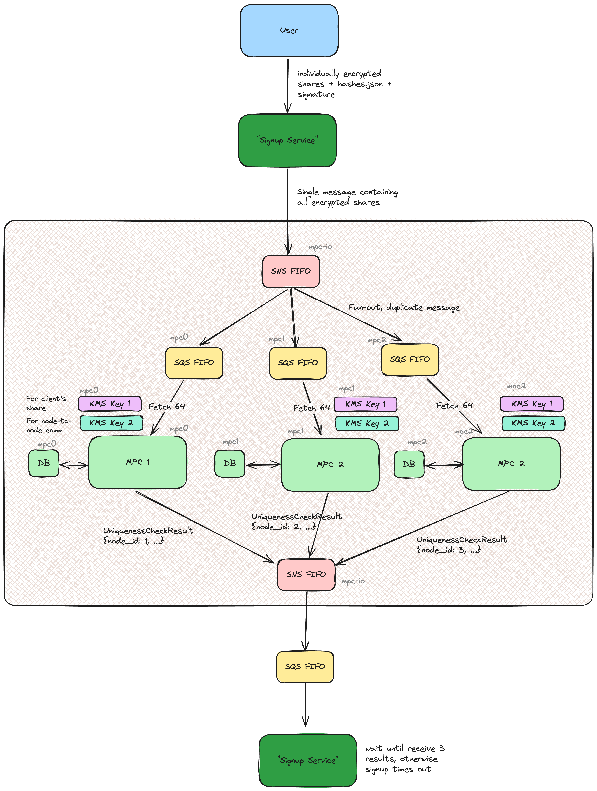

# iris-mpc

## Contributing

We welcome contributions to this project! Please follow these guidelines when contributing:

### Pull Requests

- Fork the repository and create a new branch for your changes
- Make your changes and ensure all tests pass
- Submit a pull request with a clear description of your changes
- All pull requests will be reviewed before merging

### Signed Commits

- All commits must be signed with your SSH/GPG key
- Configure Git to sign commits automatically:

    ```bash
    git config --global user.signingkey <SSH signing key path/your-gpg-key-id>
    git config --global commit.gpgsign true
    ```

- Verify your commits are signed with `git log --show-signature`

### Code Standards

- Follow the existing code style and conventions
- Include appropriate tests for new functionality
- Update documentation as needed

### Pre-commit hooks
We use pre-commit hooks to ensure our changes adhere to the project's standards. Please set up pre-commit hooks by running:
```bash
./scripts/setup-pre-commit.sh
pre-commit run --all-files
```

## How to release

New releases are created automagically by [Release Drafter GH action](https://github.com/worldcoin/iris-mpc/actions/workflows/release.yaml).

Type of release bump is made of commits (tags feat/bugfix/etc...).

Release is created as draft, so you have to edit it manually and change it to final.

After release creation the build image is starting with tag with release number.

## Setup

- CPU linear-scan implementation (the `iris-mpc-linear-scan` binary) in `iris-mpc-bins/bin/iris-mpc/server/iris_mpc_linear_scan.rs`
- CPU (HNSW) implementation (the `iris-mpc-hawk` binary) in `iris-mpc-bins/bin/iris-mpc/server/iris_mpc_hawk.rs`
- Example client in `iris-mpc-bins/bin/iris-mpc/client/client.rs`

## Security Model

The architecture of the CPU implementation is based on the "semi-honest, honest majority" assumptions for the three participating parties.  This means that the protocol is meant to be secure under the assumptions that:

1. All parties run their client code and configurations faithfully ("semi-honest")
2. At most one party out of the three may act adversarially to attempt to degrade the security properties of the system, i.e. in a three-party system, there is no collusion between multiple parties ("honest majority")

This security model forms the baseline of the implementation, and any attacks or exploits which can succeed under these fairly strong assumptions should be considered meaningful vulnurabilities.  Attacks or exploits which require weakening of these assumptions to be viable are not considered critical.  However, the codebase does incorporate some mechanisms targeting "defense in depth", providing redundant protections or limited protections under weaker adversarial assumptions, so reports of such attacks are welcome and may be acted on if the costs of mitigation to performance and codebase complexity are acceptable.

### Public key registries

`keys.json` contains production keys; `keys-staging.json` contains staging keys. Each registry's `iris.parties` array contains exactly one entry per party: `fau` → share 0, `berkeley-university` → share 1, `kaist-university` → share 2. Array order does not matter.

| Field | Value |
|---|---|
| `slu` | Party identifier above. |
| `key_b64` | Canonical padded standard base64 encoding of a 32-byte public key, without whitespace. |
| `pub` | HTTP(S) URL or nonempty URL array; every endpoint must serve exactly the `key_b64` text. Credentials and fragments are forbidden. |
| `chk` | `sha256:<64 hex digits>` or `sha512:<128 hex digits>`; hex is case-insensitive. Hash the ASCII base64 text, without JSON quotes or a newline, not the decoded key bytes. |

Retain `pub` and `chk` for older clients.

CI validates both production and staging registries. Every mirror must pass; download failures also fail validation. Downloads have a 30-second timeout and 1 MiB limit. This repository's raw GitHub URLs targeting `main` use checkout files, which must not contain symlinks. Configure `Validate public key registry` as a required status check to enforce the gate.

For production rotation, coordinate publication of the same new key to every remote source in `pub` (including `pki-smpc.worldcoin.org`) with a PR updating `certs/party-N.pub`, `key_b64`, and `chk`. Calculate SHA-256 with `shasum -a 256 certs/party-N.pub` and prefix the digest with `sha256:`. Update staging keys and their snapshots in `keys-staging.json` as needed; CI checks their embedded values and every listed location.

Validate either registry against the checkout:

```sh
python3 scripts/check-key-checksums.py keys.json --repository worldcoin/iris-mpc --repo-root .
python3 scripts/check-key-checksums.py keys-staging.json --repository worldcoin/iris-mpc --repo-root .
```

## CPU Implementation

CPU linear scan is the maintained matching service. See [GPU retirement](docs/gpu-retirement.md) for the removal scope and retained compatibility contracts.

### Messaging regions

`SMPC__REQUESTS_QUEUE_REGION` overrides the matching service's input SQS region.
`SMPC__RESULTS_TOPIC_REGION` overrides the result SNS region for both the matching
service and `iris-mpc-anon-stats-server`. Both are optional and fall back to the
shared AWS region (`SMPC__AWS__REGION`). Other clients, including S3 result
payload offloading, keep their existing region configuration.

### Requirements

1. `direnv` installed on your machine
2. Run `direnv allow` in the root of the project. This will enable you to load all required env variables from the .test.env and .envrc files

#### Option 1: Locally run a single server without Docker (recommended for quick iteration)

**Step 1: run ancillary services**

```
docker-compose -f docker-compose.dev.yaml up
```

**Step 2: run service with the init script for Party 0**

```
./scripts/run-server.sh 0 --init-servers # change to 1 or 2 for other parties
```

The script must run with `--init-servers` flag at least once. It will create some AWS resources, but after that it can run without it.

```
./scripts/run-server.sh 1
./scripts/run-server.sh 2 # in a separate shell
```

#### Option 1a: Use a pre-populated database for hawk or genesis
The files `docker-compose.genesis-db.yaml` and `docker-compose.hawk-db.yaml` use a persistent volume. The user still has to populate the database before use. This is accomplished with the `init-test-dbs` executable.

For genesis, `Dockerfile.postgres` is provided, which includes a start-up script to clear the CPU databases on each run. No such functionality is provided for hawk - the database and graph are not reset between runs.

#### Option 2: Run everything with docker

Just run

```bash
docker build -f Dockerfile.dev.hawk -t hawk-server-local-build:latest .
docker-compose -f docker-compose.test.yaml up
```

It will bring up the 3 parties plus all the needed AWS/DB resources

### Running Requests Against the Local Servers

In either option you can send batches of requests to the SNS topics that will then be forwarded to the SQS
queues from which the servers can read. This can be done with the `client` binary. We provide a bash script to
simplify its invocation:

```bash
./scripts/run-client.sh
```

This will send a batch of requests to the SNS topic. You can also run the client by itself with the `--help` flag to see all the available options.
Check out also the [client.rs](iris-mpc/src/client.rs) file for more details.

### Running Requests with file data

```bash
cargo run -p iris-mpc-bins --bin client -- \
    --request-topic-arn arn:aws:sns:us-east-1:000000000000:iris-mpc-input.fifo \
    --requests-bucket-name wf-smpcv2-dev-sns-requests \
    --public-key-base-url "http://localhost:4566/wf-dev-public-keys" \
    --region us-east-1 \
    --response-queue-url http://sqs.us-east-1.localhost.localstack.cloud:4566/000000000000/iris-mpc-results-us-east-1.fifo \
    --data-from-file signup_sequence_shares_optin_both_sides.json \
    --populate-file-data-limit 0
```

- 0 is to use all data in file otherwise one can specify a limit

This will send a batch of requests to the SNS topic. You can also run the client by itself with the `--help` flag to see all the available options.
Check out also the [client.rs](iris-mpc/src/client.rs) file for more details.

#### Testing

```
cargo test --release -- --test-threads=1
cargo test --release --features db_dependent -- --test-threads=1 # require a runnning postgres instance
```

If you are using `cargo test` with non-standard library paths, you might need [a workaround](https://github.com/worldcoin/iris-mpc/issues/25).

## CPU Genesis
1. Create the generated data (this will be generated to the `iris-mpc-bins/data` folder)

- note you can change the value of the benchmark data to generate less data (100 is required for local stack) in `iris-mpc-bins/resources/iris-mpc-cpu/construct_graph_ptxt_benchmark.toml`

```bash
cd iris-mpc-bins && cargo run --bin construct-graph-ptxt -- --job-spec resources/iris-mpc-cpu/construct_graph_ptxt_benchmark.toml
```

2. Build the hawk genesis binary

```bash
docker build -f Dockerfile.genesis.dev.hawk -t hawk-server-genesis:latest .
```

3. Run the upgrade server
* note this also instantiates a shares database for Genesis to use (the default is 100). You can edit the value for this in `docker-compose.test.genesis.yaml`
* by default genesis runs with a max index of 100. This can be edited in `scripts/run-sever-docker.sh`
```bash
docker-compose -f docker-compose.test.genesis.yaml up
```

Note: This also instantiates iris shares db with shares

## Architecture



## How to run client in the prod-dev env

```bash
cargo run -p iris-mpc-bins --release --bin client -- \
    --request-topic-arn arn:aws:sns:eu-north-1:767397716933:gpu-iris-mpc-input.fifo \
    --request-topic-region eu-north-1 \
    --response-queue-url https://sqs.eu-north-1.amazonaws.com/654654380399/temporal-results.fifo \
    --response-queue-region eu-north-1 \
    --requests-bucket-name wf-mpc-prod-smpcv2-sns-requests \
    --public-key-base-url https://d2k2ck8dyw4s60.cloudfront.net \
    --requests-bucket-region eu-north-1
```

## License

Unless otherwise specified, all code in this repository is dual-licensed under
either:

- MIT License ([LICENSE-MIT](LICENSE-MIT))
- Apache License, Version 2.0, with LLVM Exceptions ([LICENSE-APACHE](LICENSE-APACHE))

at your option. This means you may select the license you prefer to use.

Any contribution intentionally submitted for inclusion in the work by you, as
defined in the Apache-2.0 license, shall be dual licensed as above, without any
additional terms or conditions.
